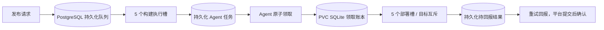

# 发布性能优化与中间件选择

本次支持默认 5 个不同任务并行构建，并通过数据库持久化队列与 Agent 本地 inbox/outbox 处理重启和网络故障。当前一个平台进程、多执行线程的部署方式无需新增 Redis、RabbitMQ 或 Kafka。未来多个构建节点或多个平台副本，需要进一步实现数据库并发领取或独立消息队列。

## 已确认的问题和实现

| 链路 | 原实现 | 本次实现 |
| --- | --- | --- |
| 状态变更 | 一次变更深拷贝整份状态两次，包含全部历史日志 | 发布阶段、取消、下发和结果回报按执行隔离；入队、配置保存、心跳共享只读历史记录 |
| 持久化 | 后台合并后仍序列化并覆盖单行完整 JSON | 配置分区、执行元数据、记录顺序、日志块分开保存，仅提交差异 |
| 日志 | 新日志触发历史状态整体写入 | 日志按 128 条分块，只写变化的块；保留全部原始日志 |
| 实时同步 | 阶段变更推送完整页面状态 | 版本化状态分区增量；缺口重连；兼容旧客户端 |
| 状态摘要 | 为寻找错误遍历全部日志 | 错误摘要仅扫描最近 200 条；完整日志接口仍可查看历史 |
| 定时调度 | 没有任务到期也复制状态、写库和广播 | 无任务到期时只读检查 |
| 源码拉取 | 每次从远端重新浅克隆 | 远端增量 fetch + 本地浅克隆，构建工作目录隔离 |
| 可写构建缓存 | Maven 等所有任务共享目录，前端可能同时改写 `node_modules` | 按任务、配置、SDK 镜像、用户组隔离，范围内加可取消的文件锁 |
| 并发执行 | 默认 1，批量数量与并发数量耦合 | 默认构建并发 5、批量 50、排队 100；镜像构建/推送分别限流 |
| Agent 部署 | 单个 Agent 串行，选择任务与登记领取分开 | Kubernetes Agent 默认 5 槽；原子领取、请求幂等、相同部署目标互斥 |
| 任务可靠性 | 内存线程池和内存待回报结果依赖进程存活 | 平台关键节点提交后确认；Agent 本地持久化领取记录和结果 |

Git 缓存每次必须成功获取远端分支，不会在远端失败时发布旧缓存。缓存范围包含凭据 ID 与用户组；凭据轮换或撤销后仍由本次远端 fetch 决定是否可用。分支前进、强制回退、工作目录隔离和远端失败都覆盖了真实 Git 命令测试。

Windows Agent 的身份检查、下载鉴权、心跳和空闲任务领取也避免复制全量历史；正在运行的 Windows 发布仍不会被重复领取或切换到另一个实例。

## 五任务并行的具体规则

Python 线程负责调度 Docker、Git 和 kubectl 等外部命令，实际编译在独立容器中执行，不受 Python GIL 限制。默认参数如下：

| 参数 | 默认值 | 含义 |
| --- | ---: | --- |
| `MAX_CONCURRENT_EXECUTIONS` | 5 | 同时占用构建执行槽的任务数 |
| `MAX_QUEUED_EXECUTIONS` | 100 | 等待构建的任务上限；线程池另有运行数加排队数的容量约束 |
| `MAX_BATCH_DEPLOY_TASKS` | 50 | 每次批量提交上限，独立于执行并发数 |
| `MAX_DOCKER_BUILDS` | 2 | Docker 镜像构建阶段的并发数 |
| `MAX_IMAGE_PUSHES` | 2 | 镜像推送阶段的并发数 |
| `SDK_BUILD_CPUS` | 2 | 每个 SDK 编译容器的 CPU 上限 |
| `SDK_BUILD_MEMORY` | 4g | 每个 SDK 编译容器的内存上限；超限可能 OOM |
| `MAX_AGENT_DEPLOYS_PER_CLUSTER` | 5 | 平台允许每个 Kubernetes 集群占用的部署槽数 |
| `AGENT_MAX_CONCURRENT_TASKS` | 5 | 每个 Kubernetes Agent 的执行线程数，在 Agent 中配置 |

5 个不同任务可同时编译，进入镜像阶段后默认只有 2 个同时构建或推送，其他任务等待对应阶段槽。硬件和仓库带宽充足时可将这两个阶段参数也设为 5。阶段等待、缓存等待均记录耗时且可取消。排队中的 Future 可以直接取消并释放容量。

发布互斥以稳定的 `taskId + deployConfigId` 为单位。同任务不同配置可独立发布和构建，同配置的重复发布仍被拒绝（复用同一 requestId 的重试仍返回原执行）。批量 API 允许同一任务的不同配置出现在不同 item，同配置重复 item 会使该批原子失败。未记录配置 ID 的旧活跃执行会保守阻止该任务所有配置，直到结束或取消。所有配置仍共享平台的 5 个默认构建槽、100 个排队名额和镜像阶段限流。

不同任务或配置如果部署到同一个 `集群 + namespace + Deployment`，平台会保留部署锁，只允许一个 Kubernetes Agent 执行；取消后也等待原 Agent 确认停止再放行。不同目标可并行。该锁覆盖平台生成的 Deployment/Service/Ingress（它们使用相同应用名），不分析自定义命令对其他外部系统的副作用。CF Pages 同配置互斥；不同配置的自定义命令若实际指向同一个 Pages 项目，平台不会自动识别，应由配置维护者确保它们操作独立目标或避免同时提交。

运行状态保存在执行记录中；任务附带按当前配置汇总的 `configExecutions`，仅含执行 ID、配置名、分支、发布人、状态、阶段、进度与时间，不包含历史日志、环境变量或配置快照。摘要不会因该执行移出最近 50 条历史而丢失；已删除配置的历史摘要不无限累积，原始执行和日志仍保留。任务总状态选择最新的活跃执行，没有活跃执行时选择最新提交的执行，避免一个配置完成后把另一个运行中的配置隐藏。

通知和构建/部署恢复使用各自执行的配置快照与发布人，不再因另一配置后来入队而遗漏通知或串用目标。取消以执行 ID 为准。定时计划按任务/配置替换，其他配置的计划继续保留；到期时相同配置忙则保持待执行。Windows 回滚检查所选配置，单台 Windows 服务器的部署顺序保持不变。

Git 缓存只在 fetch 和创建独立本地工作区时加锁，不覆盖后面的编译。所有可写 SDK 缓存按任务/配置隔离，避免 Maven `install`、SNAPSHOT 或依赖安装相互覆盖，代价是需要更多磁盘和首次缓存预热。并发期间跳过全局 Docker prune，避免破坏其他任务正在使用的构建缓存。

Windows Agent 保持每台服务器串行切换服务；5 个不同任务的构建仍可并行，发布到不同 Windows 服务器也可并行。本次没有把单台 Windows/MT5 服务器的服务切换改为 5 并发。

## 硬件建议

以下为构建机与平台/PostgreSQL 同机部署的容量规划起点，并非实测生产吞吐保证；业务 Kubernetes Pod 的运行资源另算。

| 5 并发场景 | CPU | 内存 | 本地磁盘 | 适用条件 |
| --- | --- | --- | --- | --- |
| 轻量前端、Python、小型 Go 项目起步 | 12 vCPU | 32 GB | 200 GB SSD | 单构建实测峰值约 2–3 GB，镜像阶段限流 2 |
| Java/前端混合，推荐 | 16 vCPU | 64 GB | 500 GB NVMe SSD | 5 个 SDK 容器各 2 CPU / 4–6 GB，预留 Docker 与数据库资源 |
| 大型 Maven 多模块或大型前端 | 24–32 vCPU | 96–128 GB | 1 TB NVMe SSD | 每个 SDK 容器可能需要 4 CPU / 8–12 GB，须按构建实测调参 |

内存估算：`5 × 单构建峰值 + 平台/历史状态 2–4 GB + PostgreSQL 2–4 GB + Docker 构建 4–8 GB`，再预留约 25%。例如单构建峰值 4 GB 时合计约 28–36 GB，预留后约 35–45 GB，推荐选择 64 GB 档位；32 GB 起步仅适合峰值较小的任务。SDK 的 `--memory` 是上限，并不提前预留内存，也不覆盖宿主 Docker daemon 的镜像构建内存。

磁盘估算：`5 ×（源码 + 编译产物 + Docker context）+ 所有任务的持久依赖缓存 + Docker 镜像/层缓存 + PostgreSQL/WAL/日志`；维持至少 20% 空闲。大量任务各自持有 Maven 缓存时 200 GB 可能不足，需要按缓存增长调整。镜像仓库建议同地域、至少 1 Gbps 内网；频繁推送大镜像可使用 10 Gbps。100 Mbps 外网下多路推送会争抢带宽，增加并发可能更慢。

Kubernetes Agent 主要运行 kubectl，不执行业务编译。清单默认请求 `0.5 CPU / 512 MiB`、限制 `2 CPU / 1 GiB`，使用 1 GiB RWO PVC 保存 SQLite 账本；大量失败诊断输出时可把内存上调到 2 GiB。需要集群默认 StorageClass，或手工配置适用的存储。不同 Agent 必须使用不同账本目录/PVC，同一目录有进程锁防止两个进程同时恢复或执行。

## 持久化队列与故障行为

平台数据库保存待执行记录，线程池只是执行器。提交发布、定时计划、开始执行、下发/领取 Agent 任务、结果确认和取消等关键节点会同步等待事务提交；普通日志和配置仍后台合并写入。Agent 从平台拉任务，无需平台主动连接业务集群。



| 故障点 | 行为 |
| --- | --- |
| 平台任务提交前数据库不可用 | 不确认成功，不交给执行线程；恢复后可用同一 `requestId` 查询/重试 |
| 数据库已提交，线程池尚未接到任务时平台退出 | `queued` 记录保留，重启后的调度器继续提交 |
| 本机构建命令已经运行时平台退出 | 执行标记为中断，保留日志和记录；先检查残留 SDK 容器，再人工重新发布 |
| 平台重启时 Agent 正在发布 | 保留 Agent 工作与部署锁，等待原 Agent 回报，不重新投递正在运行的命令 |
| Agent 领取 HTTP 响应丢失 | 本地先保存 claim request ID，重试时平台返回同一次领取 |
| Agent 本地账本写入失败 | 不执行尚未记录的 kubectl；保留请求用于重试 |
| 发布完成但平台结果接口不可用 | 结果已保存本地 SQLite，每个执行槽独立重试；Agent 重启后继续回报，不重跑命令 |
| Agent 重启时命令结果尚未持久化 | 报告“结果不确定”的失败，不自动重放；人工检查实际 Kubernetes 状态后重试 |
| 平台取消时 Agent 仍在执行 | 保留部署锁到原 Agent 确认结束，避免新版本与旧命令并发覆盖；kubectl 命令默认超时 300 秒 |
| Agent PVC/数据库丢失或被恢复到旧备份 | 无法承诺自动恢复全部最新任务，需运维核对；缺失任务的回报返回错误，Agent 不删除待回报结果 |

请求超时属于“结果未确认”，不是“请求一定失败”。单次发布与批量 item 均支持 `requestId`，在同一操作者和任务内复用该 ID 可返回原执行，参数不同会拒绝。页面在同一对话框中重试会复用 ID；重新打开对话框代表新的发布意图。幂等记录随执行历史保留，删除任务及其历史后不再提供该历史请求的去重。

这是持久化任务、领取幂等和可恢复结果回报的组合，不承诺外部部署副作用 exactly-once。独立的 RabbitMQ/Redis 也不能消除“命令已执行但 ACK 未到达”的窗口。对这类不确定状态，本次采取保留记录、失败提示和人工核对。

如果 Agent 的持久卷已不可恢复、旧命令也已确认停止，可先取消发布，再由具有集群管理和任务发布权限的用户调用 `POST /api/agent/tasks/{agentTaskId}/release`，body 为 `{"confirmedStopped":true}`，释放遗留的 Kubernetes 部署锁。接口会记录审计，不允许释放仍属于活跃发布的锁。不要在旧 Agent/kubectl 仍运行时释放。

## 合成基准

执行 `python3 tests/benchmark_release_state.py` 可复现。脚本生成 100 条执行记录、共 100,000 条日志，完整 JSON 约 103.9 MB；数据库使用临时的内存 SQLite，不访问平台真实数据。

2026-11-10 本地一次运行结果：

| 指标 | 测量结果 |
| --- | ---: |
| 原模式两次全量深拷贝，中位数 | 229.288 ms |
| 原模式完整 JSON 序列化，中位数 | 291.118 ms |
| 新模式阶段更新，中位数 | 0.454 ms |
| 新模式配置变更，中位数 | 0.208 ms |
| 单次追加日志的增量保存 | 0.432 ms |
| 原模式序列化数据量 | 103,897,893 bytes |
| 本次追加日志序列化的数据量 | 108,081 bytes，2 个业务数据行 |

前两项分别测量旧实现的核心开销，新模式包含对应的状态更新函数；这些不是生产 API 的端到端延迟。增量保存计时使用内存 SQLite，不能推算生产 PostgreSQL 的网络、磁盘或事务延迟。初始化迁移仍需写入全部历史数据，后续才按变化写入。

自动化验证覆盖 SQLite 升级、重载、配置与日志保留、事务失败回滚、失败后重试、删除和日志截断、并发日志顺序、状态快照隔离、旧版/新版推送协议以及真实 Git 缓存操作。新增 PostgreSQL 集成测试由 CI 的临时 PostgreSQL 16 服务执行，本地没有设置专用测试连接时会跳过。真实 Docker 构建和镜像仓库链路仍需在可用环境验证；当前本机 Docker daemon 未启动。

## 后续版本的性能约束

根目录 `AGENTS.md` 将这三项优化、至少 5 并发和关键确认落盘语义列为持续开发约束，适用于后续功能、修复、重构和依赖升级。`.github/pull_request_template.md` 要求每次评审交代状态处理、数据库写入和缓存的影响，以及测试和适用边界。

`.github/workflows/regression.yml` 在 PR、main 和 `codex/**` 分支推送时运行 Python、Node 回归和 Compose 配置检查。工作流使用独立 PostgreSQL 16 服务验证真实事务、升级回滚、日志截断、删除、重连重载和增量保存，不使用平台数据库。仓库规则和工作流不能替代 GitHub 分支保护；若要强制合并前通过，应在仓库规则中要求 `regression` 检查成功。

`tests/test_performance_contracts.py` 使用确定性数据量约束，避免把不同机器的毫秒数当门禁：

| 场景与数据规模 | 约束 |
| --- | --- |
| 从 2 条增长到 64 条执行，每条 511 条约 1 KiB 日志；追加一条日志并更新版本号 | 两种规模均只写 2 个业务数据行，序列化载荷相等且不超过 140,000 bytes |
| 执行状态变化，已有日志对象共享 | 不读取/遍历/序列化日志内容，只写一条元数据且载荷不超过 256 bytes |
| 在 64 条历史执行前插入一条带日志的新执行 | 只改版本号、顺序、新执行元数据和新日志块；不重写旧执行元数据或日志，载荷不超过 2,048 bytes |
| 从 50 增加到 250 条历史执行/Agent 任务 | 精简快照与执行分区广播保持同一内容，测试快照和增量各不超过 100,000 bytes，并验证凭据/manifest 不外泄 |

这里的字节数是应用序列化载荷，业务行数不含 DDL 与格式标记；它们不代表 PostgreSQL 实际网络流量、磁盘页或 WAL。快照预算针对固定测试配置，任务配置等分区仍会随配置数量增长。现有状态性能测试同时禁止热路径复制完整历史、验证快照隔离、空闲调度无写入和并发日志顺序；Git 测试验证重复执行只从本地对象缓存克隆，仍逐次 fetch 远端，并检查新提交、强制回退与远端失败。

`tests/test_config_releases.py` 验证同任务 5 个配置实际同时执行、同配置原子互斥、批量幂等/回滚、独立取消/定时/通知、目标串行、Windows 配置回滚、重启与历史窗口。配置摘要刷新只处理执行元数据，不复制日志；日志追加路径不刷新整组配置摘要。状态更新仍会更新任务配置分区以及对应执行记录（没有新增数据库表或修改队列确认边界），测试将一次带配置摘要的阶段更新限制为不超过 3 个业务行、25,000 bytes，并验证无关的 1,000 条日志被完整保留。源码对象缓存、按配置隔离的可写缓存和独立工作区沿用原方案。

本地运行：

```bash
python3 -m unittest discover -s tests -q
node --test tests/*.test.cjs
docker compose config --quiet
git diff --check
```

专门验证 PostgreSQL 时，先准备可创建临时 schema 的独立测试数据库，再设置 `TEST_POSTGRES_URL` 并运行 `python3 -m unittest discover -s tests -p 'test_postgres_store.py' -v`。测试按随机 schema 隔离并清理；设置了连接但驱动缺失、连接失败或断言失败会使测试失败，不会静默跳过。禁止使用生产连接。`tests/benchmark_release_state.py` 保留为趋势分析工具。

## 构建侧的下一步配置

1. 查看同一次发布中的“等待构建槽、代码拉取、编译命令、Docker 构建、镜像推送、Agent 部署”耗时，先判断等待和执行各占多少。已有日志会记录前五项相关阶段耗时，Agent 完成时间可结合执行时间核对。
2. 当前默认 `MAX_CONCURRENT_EXECUTIONS=5`。观察 5 个任务同时执行时的 CPU、RSS、OOM、磁盘 IO、缓存等待和总吞吐，再决定是否增加并发或提高单容器限制；增加线程数不会自动缩短单次编译。
3. Maven 下载缓存已启用。多模块项目按需要使用 `-pl <模块> -am`；确认业务允许后减少不必要的 `-U`，评估是否需要每次 `clean`。不要为了速度直接跳过既有测试门禁。前端可在锁文件固定、平台自动安装适用时只配置构建命令，避免额外重复安装。
4. 多构建机且依赖下载仍慢时，评估 Nexus/Artifactory；镜像推拉慢时，优先检查就近镜像仓库、镜像体积、网络和层缓存。已有 Maven/npm/Go/pip 缓存继续使用。
5. “一次构建、多环境晋级”是进一步减少全量编译的方向：保存镜像 digest、源码 commit、构建配置与依赖指纹，部署时复用已验证产物。**本次没有自动按 commit 跳过编译**：相同 commit 仍可能依赖 SNAPSHOT、可变基础镜像或外部资源；需要先确定构建可复现和产物校验规则。

## 何时加入中间件

| 需求或实测瓶颈 | 建议 |
| --- | --- |
| 单机发布平台被全量 JSON、日志写放大拖慢 | 本次增量改造，继续用 PostgreSQL |
| 多构建机反复从公网下载相同依赖 | Nexus/Artifactory 或对应语言的内网依赖代理 |
| 大量日志长期保存在内存与数据库 | 后续按保留周期归档；S3/MinIO 保存大日志和构建产物，数据库保存索引 |
| 单进程 5 并发，需要任务和结果在重启后可追踪 | 本次数据库持久化队列 + Agent SQLite inbox/outbox |
| 构建队列明显积压且需要多构建机横向扩容 | 拆分 API 与 Worker，再用 PostgreSQL `FOR UPDATE SKIP LOCKED` 领取，或 RabbitMQ quorum queue / Redis Streams |
| 多 API 实例需要共享实时事件 | 数据库作为权威状态，采用 outbox + Redis Pub/Sub/Streams 等；客户端保留版本校验和重同步 |

引入队列时必须一并实现：执行幂等键、领取租约与心跳、重试上限、取消传播、重复投递处理，以及数据库提交和入队之间的可靠交接（例如 outbox）。当前线程池和内存状态仍是单进程模型，不能因为数据库改成增量就直接运行多个写入副本。

## 升级、回退和边界

- 升级前备份现有 PostgreSQL/SQLite，先用备份副本验证。首次后台保存会在一个事务中创建新状态并提交格式标记；失败会回滚，旧数据仍可读取。
- `app_state` 的旧 `state` 行保留升级时内容，不继续更新。迁移后的日常读取以新表为准。直接回退旧镜像会看到陈旧数据；回退需恢复升级前备份并明确接受该时间点之后的变更丢失，或先将最新新表数据转换回旧格式。
- 保持一个平台写入进程，内部可以多线程执行。发布队列与确认节点已同步持久化，普通日志和配置仍有约 1 秒合并窗口。数据库自身的可靠性取决于持久卷、同步提交配置与备份策略。
- Git 缓存默认开启，`GIT_SOURCE_CACHE=false` 可关闭。新增缓存会占用磁盘；暂停发布并等待在途构建结束后再清理。新缓存键也会使 Node 依赖在首次构建时重新准备。
- 启动仍加载全部历史，部分管理/恢复操作仍可使用兼容的完整状态路径，完整日志接口也仍返回选定执行的全部日志。历史数量持续增长时，需要进一步引入分页、按需加载与归档；本次主要消除了日常发布链路对历史日志的全量复制、序列化和传输放大。
- 增量推送以状态分区为单位，例如执行列表仍使用最近 50 条摘要，并非每个字段的 JSON Patch。配置分区也仍按分区写入，超大任务列表可继续拆为实体表。
- 增量存储仍遍历执行记录的 ID/顺序；变化执行的日志仍比较已有块，状态修改仍复制当前执行的日志引用列表。它们避免复制全部日志内容或跨数据库重复传输，但并非所有 CPU 操作均为 O(1)。下一阶段优先按需加载历史/日志分页、记录级变更跟踪与日志追加游标，再按实测评估中间件。
